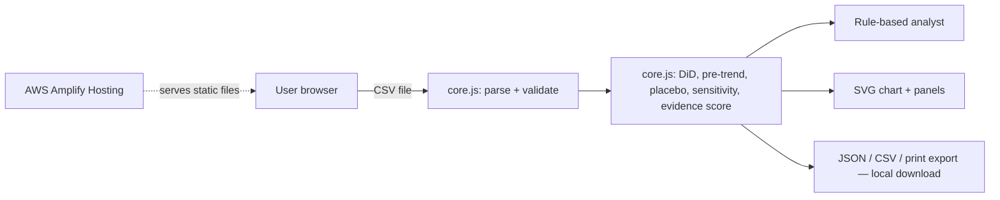

# HeatProof — Urban Cooling Impact Auditor
*Measure the cooling. Verify the impact.*

An **impact-auditing and decision-support prototype**. It compares surface-temperature trends in intervention (treatment) vs. control sites before/after an intervention, then tells you **how much to trust that comparison**. It does not prove causation.

## Run (no network, no credentials, no build step)
```bash
npm test                 # 14 core tests (Node ≥18)
npm start                # serves http://localhost:8080  (or just open index.html in a browser)
npm run generate-data    # regenerate the seeded SYNTHETIC datasets
```

## Workflow
Study → Import CSV → Validate → Analyze → Evidence → Export (JSON / CSV / print-to-PDF).

## What's implemented
- **Counterfactual analysis:** DiD on the per-date treatment−control gap; Welch 95% CI only when ≥4 pre and ≥4 post dates, otherwise "descriptive only".
- **Control-comparability checks:** pre-period gap-trend test, placebo-date test, window-sensitivity (drop dates nearest the intervention).
- **Cooling Evidence Score (0–100):** equal-weight mean of six documented components (dates, sites, completeness, data-quality flags, pre-period comparability, provenance). It is a *completeness heuristic* — **not** statistical confidence and **not** P(intervention worked). Un-computable components are listed as unscored.
- **Data validation:** quote-aware CSV parsing; invalid date/group/unit/temperature rejected with row numbers; missing values kept as missing; duplicates flagged + averaged; outliers flagged (modified z > 3.5, Iglewicz–Hoaglin), never removed; uneven groups; calendar gaps.
- **Rule-based analyst:** deterministic text built from computed values; separates observed / uncertainty / hypotheses / next evidence. **No AI model is used.**
- **Safety:** all imported text rendered via `textContent`; strict CSP; synthetic data labelled in UI and every export.

## CSV schema
`site,date,group,surface_temp_c[,unit]` — group ∈ {treatment, control}; date `YYYY-MM-DD` (calendar date, no time-zone conversion); temperature °C (Celsius only; −60…90). Extra columns are ignored.

## Data honesty
`data/*.csv` are **synthetic** (seeded generator `scripts/generate-data.js`). `demo_synthetic.csv` has a built-in −1.2 °C effect, one injected outlier and two missing cells. `misleading_synthetic.csv` has **zero true effect** but the treatment sites were already cooling before the intervention — naive DiD shows ≈ −0.9 °C; HeatProof flags diverging pre-trends.
**Real satellite data is not integrated.** Realistic path: export Landsat 8/9 Collection 2 Level-2 surface temperature (USGS; ~30 m, 16-day revisit) or ECOSTRESS/MODIS LST (NASA) for site polygons via Google Earth Engine / AppEEARS / USGS EarthExplorer, aggregate per site and date to this CSV, and record product, date range and attribution in the Source fields. Verify each product's licence and cloud-masking before use. Land-surface temperature ≠ air temperature ≠ heat index ≠ human exposure.

## Architecture (simplest viable: static, client-side)

All computation is in the browser; data never leaves the device. **AWS status: deployment-ready, NOT deployed or tested on AWS.** Lambda/API Gateway/S3/Bedrock were deliberately omitted — nothing in the prototype needs them. Add S3 (private bucket, presigned URLs) only if you need shared study storage.

## Deploy to AWS Amplify Hosting (beginner path)
1. Push this folder to a GitHub repo. 2. AWS Console → **Amplify → Create new app → Host web app** → pick the repo/branch. 3. Amplify detects `amplify.yml` (runs tests, publishes the static files). 4. Open the generated `*.amplifyapp.com` URL and run the demo. 
Manual alternative: Amplify → *Deploy without Git* → drag-and-drop a ZIP containing `index.html`, `app.js`, `core.js`, `samples.js`.
**Least privilege / cost:** use an IAM Identity Center or IAM user limited to Amplify actions (not AdministratorAccess); no keys in code (none needed); enable a **AWS Budgets** alert (e.g. $5); static hosting costs are typically cents at demo scale — check current pricing. Delete the app after judging.

## Known limitations
Intervals assume independent dates (optimistic with autocorrelation); a high evidence score can still coexist with a flagged comparability problem — read the warnings, not just the number; no real-data connector; PDF is via the browser's print dialog; no persistence between sessions; UI tested headlessly (jsdom) but not across browsers/screen readers.
